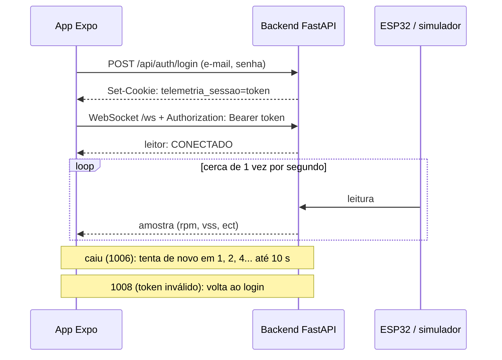

# Roteiro da apresentação (10 min + 2 de perguntas)

## 1. O TCC e o problema (1 min)
- ODB2 + MS41 Telemetry: lê os parâmetros do motor com hardware barato e mostra em tempo real.
- Hoje a telemetria ao vivo só aparece no navegador do computador. Quem está dentro do carro precisa ver no celular.

## 2. Pergunta e escolha (1,5 min)
- Pergunta: como o WebSocket nativo do React Native consome a telemetria de um backend que exige login, mesmo quando a conexão cai?
- Alternativas: polling com `fetch`, `socket.io-client`, `react-query`, WebSocket nativo (tabela do `PESQUISA.md`).
- Por que o WebSocket nativo: o backend já fala WebSocket puro e o React Native aceita headers no 3º argumento.

## 3. Como funciona (2 min)

## 4. Demonstração (3 min)
Um critério por vez, com o celular espelhado:
1. Login e valores mudando, bolinha verde.
2. Modo de autenticação e estado do leitor na tela.
3. Senha errada.
4. Endereço errado.
5. Ctrl+C no backend: amarelo e esmaecido; sobe de novo: volta sozinho.
6. Trocar a senha pelo navegador: em até 30 s, "Sessão expirada".

Se a demonstração ao vivo falhar, passar o vídeo de 1 minuto.

## 5. Onde a IA errou (1,5 min)
- A IA tirou uma conversão de tipo necessária: o runtime aceita headers, mas o TypeScript do Expo usa os tipos do DOM. O `tsc` pegou.
- Uma documentação não oficial apareceu na busca como se fosse a do React Native; a confirmação veio do código-fonte.
- A apostila diz que o MCP do Expo é gratuito; a página oficial diz que exige plano pago.
- [o erro do Copilot que você registrar]

## 6. Próximos passos (1 min)
- O backend não precisou de mudança nenhuma: o Bearer no `/ws` já resolve.
- Guardar o token com `expo-secure-store`, achar o backend na rede sem digitar IP, levar as telas de histórico para o app no TCC 2.
